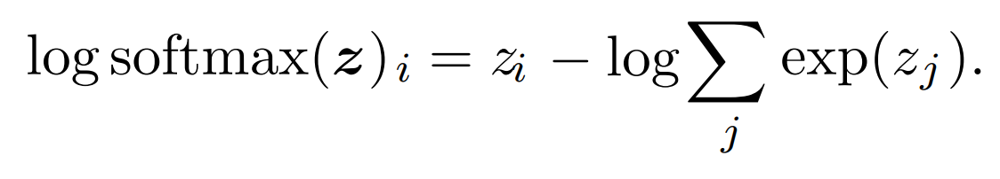
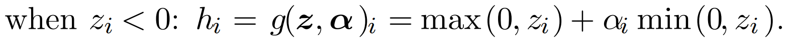

# Chap 6: Deep Feedforward Networks

## Sigmoid function

Unnormalized probabilities is called $z$, I think it's the outputs from some node in the network before we turn it into a final real probabilities that are able to be summed to 1.

Section 6.2.2.2 - Sigmoid Units for Bernoulli Output Distributions - is hard to follow, I checked this reference from stack exchange(https://stats.stackexchange.com/questions/269575/motivating-sigmoid-output-units-in-neural-networks-starting-with-unnormalized-lo).

### 6.2.2.3 Softmax Units for Multinoulli Output Distributions

How to under stand this? 

> The intuition we can gain from this approximation is that the negative
> log-likelihood cost function always strongly penalizes the most active incorrect
> prediction. If the correct answer already has the largest input to the softmax, then
> the −zi term and the logj exp(zj) ≈ maxj zj = zi terms will roughly cancel.
> This example will then contribute little to the overall training cost, which will be
> dominated by other examples that are not yet correctly classified.

Sigmoid used for binary classifications; Softmax used for multiclass problems.

One drawback for ReLU:to rectified linear units is that they cannot learn via gradientbased methods on 

examples for which their activation is zero

- Absolute value ReLU: $a_i =-1$
- Leaky ReLU: $a_i = 0.01$

maxout unit

Model more close to Linear, easier to optimize, because cost function for Linear model are more likely to be convex. LSTM uses summation to pass information through time steps, which is Linear combination through time(derivative equals to 1), makes it more powerful.
